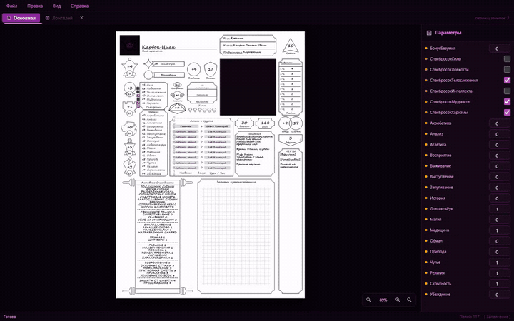

# 🎲 Disco & Dragons — Редактор Анкет (веб-версия, Act 4)



> **Шрифты.** Редактор использует Segoe Script, файлы шрифта принадлежат Microsoft и в репозиторий не входят. Скопируйте `segoesc.ttf` и `segoescb.ttf` из `C:\Windows\Fonts` в `assets/fonts/` (см. `assets/fonts/README.md`). Без них не работает экспорт в PDF, а лист отображается запасным шрифтом.
>
> **Лицензия.** Файл лицензии не добавлен: по умолчанию все права сохраняются за автором. Код можно смотреть; для использования напишите автору.

Веб-версия [Act 3](../Disco&Dragons%20Sheet%20Generator%20Act%203) — редактора анкет
персонажей D&D. Работает целиком в браузере: **никакого сервера, никакой базы
данных**, только статические файлы. Достаточно открыть сайт.

Анкета — это набор абсолютно позиционированных полей поверх фона A4, плюс
страницы заметок; результат экспортируется в PDF.

---

## Запуск

### Локально

ES-модули и `fetch` не работают по протоколу `file://`, поэтому нужен любой
локальный сервер:

```bash
python -m http.server 8000
```

Затем откройте <http://localhost:8000>.

### GitHub Pages

1. Создайте репозиторий и запушьте содержимое этой папки в ветку `main`.
2. **Settings → Pages → Build and deployment → Deploy from a branch**,
   ветка `main`, папка `/ (root)`.
3. Готово. Файл `.nojekyll` в корне обязателен — без него GitHub не отдаёт
   папки, и `assets/` не загрузится.

Сборка не нужна: ни npm, ни bundler, ни GitHub Actions. Все библиотеки лежат
в `js/vendor/`.

> GitHub Pages различает регистр букв в путях, а Windows — нет. Если после
> деплоя что-то не грузится, первым делом проверьте регистр имён файлов.

---

## Что уже работает

- Заполнение всех типов полей: текст, число, формула, фото, статичное
  изображение, скрытые число/булеан, характеристики, способность.
- Живой пересчёт формул (те же функции и тот же синтаксис, что в Act 3).
- Панель «Параметры» со скрытыми полями.
- Открытие и сохранение `.ddsg` (и старых `.json`), перетаскивание файла в окно.
- Экспорт в PDF — фон остаётся вектором, шрифт Segoe Script встраивается.
- Смена фона страницы (PDF, PNG, JPG, BMP, WEBP) и сброс к стандартному.
- Масштаб: колесо мыши, кнопки, `Ctrl +` / `Ctrl −` / `Ctrl 0`.
- Автосохранение в браузере — закрытая вкладка не теряет анкету.
- Список недавних анкет.

## Чего ещё нет

- **Редактор заметок** (карандаш, ластик, текст). Страницы заметок при
  открытии и сохранении сохраняются без изменений и попадают в PDF вместе с
  нарисованными линиями, но пока не редактируются.
- **Импорт Long Story Short и DDSG Act 2.** Формат распознаётся, но открывать
  такие анкеты пока нужно в Act 3 и пересохранять в `.ddsg`.

## Чего не будет

**Режим разработчика** (редактор раскладки полей) в веб-версию не переносится:
пароль в браузерном JavaScript виден любому, а раскладку удобнее править в
десктопной версии. Веб-версия берёт раскладку из
`assets/themes/default.json`, а при открытии анкеты — из самого файла, и
сохраняет её обратно без изменений.

---

## Совместимость файлов с Act 3

Формат `.ddsg` общий, включая все legacy-ключи (`page_count`,
`page_backgrounds`, `exclude_page2_from_pdf`), так что анкету, сохранённую
здесь, откроет и Act 3. Два отличия, которых не избежать в браузере:

| | Act 3 | Act 4 (веб) |
|---|---|---|
| Фото и кастомные фоны | путь к файлу (`D:/desektop/фото.png`) | `data:` URI внутри анкеты |
| Встроенные фоны | абсолютный путь | относительный (`assets/themes/main_default.pdf`) |

Относительный путь — это скорее плюс: Act 3 разрешает его относительно своей
папки установки, поэтому такая анкета работает на любом компьютере, а не
только там, где её создали.

А вот `data:` URI Act 3 воспринимает как несуществующий путь и просто
показывает пустой слот портрета — без ошибки, но и без картинки. Если анкета
должна ходить в обе стороны с фото, вставляйте фото в той версии, где будете
его смотреть.

---

## Точность PDF

Экспорт проверен попиксельно против Act 3: на тестовых анкетах **все различия
находятся внутри рамок фотографий** (см. ниже), а текст, рамки, фоны, формулы,
переносы строк и базовые линии совпадают полностью.

Чтобы этого добиться, важны три вещи — не меняйте их, не сверившись с Act 3:

1. **Метрики шрифта берутся из таблицы `hhea`**, а не из типографских OS/2
   (`export/font-metrics.js`). Для Segoe Script на 13 пт это 20.59 пт против
   12.82 — с «правильными» метриками текст съезжает в каждом поле.
2. **Возможности OpenType выключены** (`calt`, `clig`, `liga`, `kern`) и в
   PDF, и в CSS. ReportLab их не применяет, а fontkit применяет по умолчанию:
   с ними каждая буква рукописного шрифта меняет форму на связную.
3. **Отступы и множители** из `export/text-layout.js` (3 пт по бокам,
   межстрочный 1.3, обрезка блоков способности и т. д.).

Остаточная разница внутри фото — это сглаживание полупрозрачных краёв логотипа
`assets/DnD.png` (у него 6607 пикселей с частичной альфой) и скругление уголков
заглушки. Максимальное отклонение яркости < 96 из 255, глазом не видно.

---

## Структура

```
index.html            .nojekyll
css/                  theme · layout · canvas · note-editor
js/
  core/               field-model · sheet-model · formula-parser
  ui/                 app · sheet-canvas · field-widgets · hidden-panel
                      dialogs · busy · icons · metrics · pdf-render
  export/             pdf-export · text-layout · font-metrics
  io/                 file-io · detect-format · asset-paths · store
  vendor/             pdf-lib · fontkit · pdf.js
assets/               themes (фоны + раскладка) · fonts · icons
tools/                сверка экспорта с Act 3
```

### Система координат

Всё — геометрия полей, линии заметок, текстовые рамки — хранится в **точках
PDF с началом в левом верхнем углу** (`A4 = 595.276 × 841.890`). Страница в
браузере имеет ровно такой размер в CSS-пикселях, а масштаб — это
`transform: scale()`. Поэтому **1 CSS-пиксель = 1 точка PDF**, и координаты из
модели попадают и в разметку, и в экспорт без пересчёта. Любую новую геометрию
держите в этом же пространстве.

### Формулы

Синтаксис и набор функций — как в Act 3: `ceil`, `floor`, `round`, `abs`,
`min`, `max`, `sqrt`, `log`, `int`, `float`, `mean`, `signed`, `yesno`,
`percent`. Два синтаксиса — голое выражение (`ceil((Ловкость - 10) / 2)`) и
шаблон со вставками (`+{ceil((Ловкость - 10) / 2)}`).

Парсер написан заново (в Python это был обход `ast`) и специально повторяет
особенности Python, которых нет в JavaScript: `round()` округляет к чётному,
`//` и `%` округляют к минус бесконечности, деление на ноль даёт `0`, а
`int()` отсекает дробную часть, в отличие от `floor()`. Совпадение с Act 3
проверено на 95 выражениях и на всех 35 формулах стандартного шаблона —
включая текст ошибок.

---

## Сверка с Act 3

В `tools/` лежат скрипты, которые экспортируют одни и те же анкеты обеими
версиями и сравнивают результат попиксельно. Нужны установленный Act 3 и его
зависимости (`reportlab`, `pymupdf`, `Pillow`, `pikepdf`), а также Node.

```bash
cd tools
node compare-export.mjs        # см. комментарий в начале файла
```
